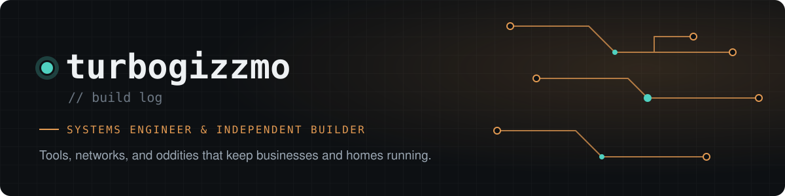

  

  

  
  
  
  
  

### `$ whoami`

I build the **tools, networks, and oddities** that keep businesses and homes running: local-first desktop apps, firewall and camera infrastructure, home-automation rigs, a few games, and clean-room rebuilds of software the world forgot.

Most of my work happens on client networks and private workbenches. This profile is where the shareable parts end up.

### `$ ls ./featured`

| | |
|---|---|
| **[LocalBooks](https://github.com/turbogizzmo/LocalBooks)** · [live ↗](https://turbogizzmo.github.io/LocalBooks/) Local-first double-entry accounting for small businesses. Your books live in one SQLite file on your machine. No cloud, no account. `Rust` `Tauri` `React` `SQLite` | **[Wave Exit](https://github.com/turbogizzmo/wave-exit)** · [live ↗](https://turbogizzmo.github.io/wave-exit/) Desktop app for accountants to pull a business's books out of Wave Accounting as archives, Excel workbooks, PDF packs, and import files. `TypeScript` `Tauri` |
| **[Plexonauts](https://github.com/turbogizzmo/plexonauts)** · [demo ↗](https://turbogizzmo.github.io/portfolio/media/plexonauts.mp4) A live Plex activity room: everyone on the server is an astronaut in a retro movie theater, seated at whatever they're streaming. `Python` `JavaScript` `WebSockets` | **[wyze-bridge-unifi](https://github.com/turbogizzmo/wyze-bridge-unifi)** Bridges Wyze cameras into UniFi Protect over ONVIF, keeping the Python + ONVIF path that upstream projects abandoned alive. `Python` `Docker` `ONVIF` |
| **[Aruba Instant On · HA](https://github.com/turbogizzmo/ArubaInstantOnPortalHA)** Read-only Home Assistant integration for cloud-managed Aruba Instant On sites: clients, networks, and site health as entities. `Python` `Home Assistant` | **[Synology Chat+](https://github.com/turbogizzmo/synology-chatplus-desktop-OSX)** A native macOS desktop client for Synology Chat. A nicer front end than the stock web app. `Rust` |

<a href="https://turbogizzmo.github.io/portfolio/"><b>→ Full build log: 35+ projects across products, games, retro rebuilds, network, IoT, and civic tools</b></a>

### `$ stack --used`

  <code>languages</code> 
  
  
  
  
  
    
  <code>frameworks &amp; data</code> 
  
  
  
  
    
  <code>infra &amp; hardware</code> 
  
  
  
  
  
  

### `$ cat ./currently`

- Shipping **LocalBooks** and **Wave Exit** for small businesses leaving cloud accounting
- Keeping old hardware useful: Wyze cameras in UniFi Protect, Aruba APs on Instant On
- Rebuilding software with no surviving source, from file formats up

### `$ ./contact`

Open to interesting infrastructure problems, small-business tooling, and anything that needs a calm fix. Open an issue on any repo, or start at the **[portfolio](https://turbogizzmo.github.io/portfolio/)**.

build · break · understand · ship · repeat
